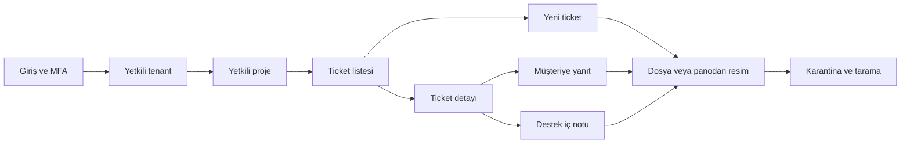
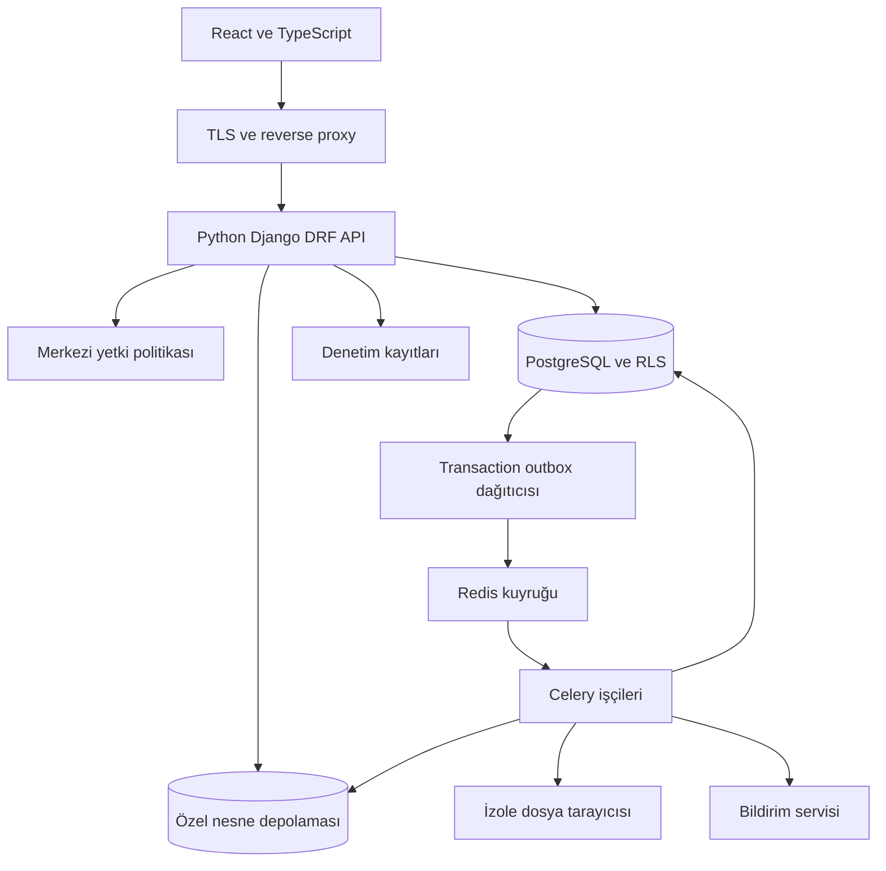

# Destek portalı ürün ve mimari planı

14 Ekim 2026 · Ürün ve mimari temel planı

Portal, bir kullanıcının yetkili olduğu birden fazla tenant ve projede destek talebi açmasını, destek ekibiyle yazışmasını ve talep veya yorumlara güvenli dosya eklemesini sağlayacak. Panodaki ekran görüntüleri editöre yapıştırılabilecek. Müşteri yanıtları, destek ekibinin iç notları ve bunların ekleri ayrı görünürlük kurallarına sahip olacak.

Son teknoloji kararı React ve TypeScript frontend, Python backend olarak alınmıştır. Backend Django ve Django REST Framework ile modüler monolit şeklinde kurulacak; PostgreSQL, özel nesne depolaması ve Celery işçileri kullanılacak. İlk uygulama sürümü bu depoda geliştirilmiştir. Gerçekleşen kapsam [uygulama durumunda](uygulama-durumu.md), çalıştırma adımları [README](../README.md) içinde bulunur.

## Ürün kapsamı ve varsayımlar

Tenant, verisi ve yönetim sınırları bağımsız müşteri kuruluşudur. Proje bir tenant içindeki destek çalışma alanıdır. Bir kullanıcı birden fazla tenant üyesi olabilir ve her projede farklı rol alabilir. Proje tek tenant'a aittir; tenant'lar arasında ortak ticket bulunmaz.

Merkezi destek personeli, hizmet verdiği tenant ve projelere açıkça atanır. Platform yöneticiliği müşteri ticket içeriklerini otomatik görme hakkı vermez. Müşteri kuruluşu içindeki ekip veya departman ayrımı proje üyeliği ve ticket görünürlüğüyle yapılır. Birbirinden bağımsız müşterileri aynı tenant altında toplamak ayrı bir veri modeli kararı gerektirir.

BGYS, Bilgi Güvenliği Yönetim Sistemi olarak ve ISO/IEC 27001:2022 çerçevesinde ele alınır. Yazılım kontrolleri; kurumun risk değerlendirmesi, süreçleri ve denetim kanıtlarıyla birlikte uygulanır. Bu plan tek başına KVKK uygunluğu veya ISO sertifikasyonu oluşturmaz. ISO standardı yönetim sisteminin kurulması, işletilmesi ve sürekli iyileştirilmesine ilişkin gereksinimleri tanımlar. [ISO/IEC 27001:2022](https://www.iso.org/standard/27001)

### İlk sürüm

| Alan | İlk sürümdeki davranış |
| --- | --- |
| Tenant ve proje | Üyelik, davet, proje oluşturma, arşivleme ve bağlam değiştirme |
| Ticket | Başlık, açıklama, kategori, öncelik, durum, talep sahibi, atanan kişi ve etiketler |
| İletişim | Müşteriye açık yanıt, destek iç notu, değişiklik geçmişi |
| Dosya | Ticket ve yorum eki, sürükle bırak, dosya seçme, panodan resim yapıştırma |
| Yetki | Tenant ve proje kapsamlı roller, nesne görünürlüğü, sunucuda izin kontrolü |
| Takip | Yetkili kişilere uygulama içi ve asgari içerikli e-posta bildirimi |
| SLA | İlk yanıt ve çözüm hedefi, çalışma takvimi, bekleme ve ihlal takibi |
| Yönetim | Kullanıcılar, roller, projeler, kotalar, saklama politikaları |
| Güvenlik | MFA, denetim kaydı, karantina, antivirüs, erişim iptali |
| Gizlilik | Aydınlatma sürümleri, ilgili kişi başvurusu, imha ve dışa aktarma süreçleri |

Bilgi bankası, gelişmiş otomasyon, dış entegrasyonlar, e-postadan ticket açma, mobil uygulama, AI/OCR ve faturalama sonraki sürümlere ayrılır. İlk sürümün veri modeli bunların eklenmesine izin verir; başlangıçta ikinci backend dili veya mikroservis zorunluluğu yoktur.

## Referans ürün tasarımının uyarlanması

Referans: `C:/Users/celik/OneDrive/Documents/GitHub/fpfinansman/ui-next`.

İncelenen kaynaklar `README.md`, `package.json`, `src/styles/index.css`, `src/widgets/app-shell/AppShell.tsx`, `src/shared/api/httpClient.ts` ve `src/shared/api/command.ts` dosyalarıdır. Referans React, TypeScript, Vite, React Router, TanStack Query ve Tailwind kullanır. Sürüm numaraları uygulama başlangıcında uyumluluk ve destek durumuna göre sabitlenir; referansın bağımlılık listesi otomatik kopyalanmaz.

### Görsel dil

| Öğe | Portalda kullanım |
| --- | --- |
| Ana vurgu | Referanstaki mor `#362dae`; birincil eylemler ve aktif menü |
| İkincil vurgu | Turkuaz `#0fbaba`; destek ve bilgi göstergeleri |
| Zemin ve yüzey | Açık mavi turkuaz `#e1f0f2`, beyaz kartlar |
| Tipografi | Yerel sunulan Open Sans, açık hiyerarşi ve okunur tablo metni |
| Kabuk | Üst çubuk, daraltılabilir sol menü, sayfa başlığı ve kartlar |
| Tema | Açık ve koyu tema; normal ve sıkı yoğunluk |
| Mobil | Referanstaki 700 px eşiğinde menü çekmecesi; detay panelleri alt alta |
| Durumlar | Renk yanında yazı ve ikon; yalnız renkle öncelik veya durum anlatılmaz |

Tema belirteçleri ve genel bileşen yaklaşımı uyarlanır. Muhasebe ekranları, firma/yıl alan modeli, iş servisleri ve referansın oturum protokolü portalın alan modeline taşınmaz. Referans dosyaları değiştirilmez. Formlar, paneller ve ek önizlemeleri klavye erişimi, odak yönetimi, hata mesajları ve WCAG 2.2 AA hedefiyle tasarlanır.

### Ekran haritası

| Ekran | İçerik ve temel eylem |
| --- | --- |
| Giriş | Oturum açma, MFA, parola sıfırlama veya kurumsal SSO |
| Tenant ve proje seçimi | Yalnız mevcut üyelikler; arama, son kullanılan bağlam |
| Dashboard | Bana atanan, yanıt bekleyen, SLA riski olan talepler; yetkiye göre sayımlar |
| Ticket listesi | Filtreler, kaydedilmiş görünümler, sunucu sayfalaması ve sıralama |
| Yeni ticket | Proje, başlık, kategori, açıklama, ekler ve gönderim durumu |
| Ticket detayı | Yazışma, açıklama, ekler, atama, SLA ve zaman çizelgesi |
| Proje yönetimi | Üyeler, roller, kategoriler, SLA, çalışma saatleri ve arşiv |
| Tenant yönetimi | Davetler, yetki atamaları, kota, gizlilik politikaları |
| Denetim ve gizlilik | Filtreli olay kaydı, ilgili kişi başvuruları, imha işleri |
| Platform yönetimi | Tenant yaşam döngüsü, sistem sağlığı ve kullanım metrikleri |

Liste ekranı referanstaki üstte filtreler, hızlı eylemler ve özet kartları; altta tablo düzenini kullanır. Müşteri ve destek personeli aynı veri modeline bağlanır, fakat sunucunun sağladığı izinlere göre farklı eylem ve görünüm alır.

Ticket detayı masaüstünde solda ana yazışma, sağda durum ve atama panelidir. Yanıt editöründe görünür bir “Müşteriye yanıt” veya “İç not” seçimi bulunur. İç not ayrı yüzey ve etiket kullanır; iç nottan müşteri yanıtına geçişte ekler yeniden gözden geçirilir. Yanlışlıkla paylaşımı önlemek için yayımlanmış iç not görünürlüğü doğrudan değiştirilmez; yetkili kişi seçtiği içeriği yeni açık yanıt olarak gönderir.



## Tenant ve proje izolasyonu

Önerilen başlangıç modeli ortak PostgreSQL veritabanı ve ortak tablolar üzerinde `tenant_id`, proje kaynaklarında ayrıca `project_id` ile izolasyondur. Uygulama yetkilendirmesine ek olarak PostgreSQL Row Level Security kullanılır. RLS varsayılan ret politikasını destekler; tablo sahibi ve ayrıcalıklı rollerin atlama davranışları ayrıca yönetilmelidir. [PostgreSQL RLS](https://www.postgresql.org/docs/current/ddl-rowsecurity.html)

1. İstek önce oturumu doğrular. URL'deki tenant kimliği yalnız aday bağlamdır; aktif üyelik sunucudan doğrulanır.
2. Projenin bu tenant'a ait olduğu ve kullanıcının proje izni kontrol edilir. İstemci tarafından gönderilen `tenantId`, rol veya sahiplik alanları yazma yetkisi yaratmaz.
3. Her kapsamlı sorgu tek transaction içinde doğrulanmış tenant ve kullanıcı bağlamını `SET LOCAL` üzerinden kurar. Havuzdan alınan bağlantıda kalıcı oturum değişkeni bırakılmaz.
4. Runtime DB rolü tablo sahibi, superuser veya `BYPASSRLS` olmaz; tenant tablolarında `FORCE ROW LEVEL SECURITY` değerlendirilir. Migration ayrı rolle yapılır. Tenant ve proje ilişkileri bileşik foreign key ve unique constraint ile doğrulanır.
5. RLS tenant sınırını korur. Proje üyeliği, ticket görünürlüğü ve yorum görünürlüğü uygulamanın merkezi politika katmanında ayrıca zorunludur. Filtreli queryset kullanmadan nesne yüklenmez.
6. Arama, sayımlar, dışa aktarma, dosya indirme, bildirim, arka plan işi ve yönetim komutları aynı kapsam kurallarını uygular.
7. Ön bellekte kullanıcı, tenant, proje ve izin sürümü bulunur. Tarayıcıda bağlam değişince devam eden istekler iptal edilir; eski sonuçların yeni ekrana yazılması engellenir.

URL örneği `/t/{tenantId}/p/{projectId}/tickets/{ticketId}`. Tenant seçimi global bir çerezi sürekli değiştirerek yapılmaz; her sekmenin bağlamı URL'dedir. Böylece iki tenant iki sekmede kullanılabilir. Taslaklar kullanıcı ve bağlam bazında ayrılır; ilk sürümde hassas taslak içeriği localStorage'a yazılmaz.

Tenant değiştirme eski tenant'ın dosyasını, draft'ını veya filtre sonucunu yeni tenant'a taşımaz. Ticket'ın projesi ilk sürümde değiştirilmez. İleride aynı tenant içinde taşıma eklenirse üyelik, iç notlar, ekler, SLA ve takipçiler tek kontrollü işlemde tekrar değerlendirilir.

Yüksek izolasyon ihtiyacı olan müşteriler için sonraki aşamada ayrı veritabanı ve depolama seçeneği sunulabilir. Bu seçenek ilk sürümde zorunlu değildir; veri yerleşimi ve müşteri risk değerlendirmesiyle açılır.

## RBAC ve kayıt görünürlüğü

İzin kararı `aktif üyelik + kapsamlı rol + kaynak görünürlüğü + işlem koşulu` birleşimidir. Varsayılan ret uygulanır. Tenant kapsamındaki yönetim rolü otomatik olarak tüm projelerde ticket içeriği okuma yetkisi kazanmaz. Kullanıcı kendi rolünü yükseltemez; yalnız yetkili olduğu kapsamda ve devredebildiği izinleri atayabilir.

### Rol şablonları

| Rol | Kapsam | Varsayılan yetki |
| --- | --- | --- |
| Platform yöneticisi | Platform | Tenant ve altyapı yönetimi; ticket içeriği yok |
| Tenant yöneticisi | Tenant | Kullanıcı, proje ve politika yönetimi; içerik erişimi ayrı proje ataması ister |
| Proje yöneticisi | Proje | Proje ayarları, üyelikler, SLA ve projedeki tüm ticketlar |
| Destek lideri | Proje | Tüm ticketlar, atama, öncelik, eskalasyon ve iç not |
| Destek uzmanı | Proje | Tüm ticketlar, yanıt, iç not ve izinli durum geçişleri |
| Talep sahibi | Proje | Kendi ve açıkça katılımcısı olduğu ticketlar; müşteri yanıtları |
| Proje gözlemcisi | Proje | Projedeki müşteri görünümünü okuma; yazma ve iç not erişimi yok |
| Denetçi | Tenant veya proje | Ayrı verilen denetim metaverisini okuma; dosya ve içerik erişimi yok |

İlk sürümde hazır rol şablonları kullanılır; özel rol editörü sonraki aşamadır. Bir kullanıcının rollerinden gelen izinler yalnız ilgili kapsam içinde birleşir. Askıya alınmış üyelik bütün rollerin önüne geçer. İç not ve hassas dosya okuma ayrı izinlerdir.

### İzin sözlüğü

`ticket.create`, `ticket.read.own`, `ticket.read.project`, `ticket.reply`, `ticket.assign`, `ticket.transition`, `ticket.internal_note.read`, `ticket.internal_note.write`, `attachment.upload`, `attachment.download`, `project.manage`, `membership.manage`, `role.assign`, `audit.read`, `privacy.export`, `privacy.erase`, `emergency_access.request`.

`attachment.download` tek başına yeterli değildir: bağlı ticket ve bağlı yorum okunabilir olmalı, dosya temiz olmalı ve kullanıcı halen yetkili olmalıdır. Ticket takipçisi olmak yetki sağlamaz. Katılımcı ekleme ayrı kontrol edilir; talep sahibi herhangi bir kişiyi ekleyerek özel ticket'ı paylaşamaz.

Python tarafında tek bir politika servisi hem API nesne kontrolünü hem queryset filtrelerini sağlar. Django'nun kullanıcı ve grup izinleri temel altyapıdır; tenant/proje rol atamaları ayrı modellerdir. DRF liste uçlarında nesne iznini her kayda otomatik uygulamaz; liste filtreleme ve oluşturma kontrolleri açıkça tasarlanır. [Django izinleri](https://docs.djangoproject.com/en/5.2/topics/auth/default/), [DRF nesne izinleri](https://www.django-rest-framework.org/api-guide/permissions/)

Django admin müşteri portalı değildir. Özel ağ erişimi, MFA ve dar kapsamlı yönetim işlemleri kullanır. Django `is_superuser` bayrağı portal politika kontrollerini otomatik atlayamaz. Olağanüstü içerik erişimi gerekçe, ayrı onay, süreli tenant/proje kapsamı ve erişim kaydı gerektirir.

## Ticket iş akışı ve SLA

Durumlar: `new`, `triaged`, `in_progress`, `waiting_requester`, `waiting_internal`, `resolved`, `closed`, `cancelled`.

| Geçiş | Koşul |
| --- | --- |
| Yeni → değerlendirildi | Yetkili destek personeli kategori ve önceliği doğrular |
| Değerlendirildi → işlemde | Yetkili destek personeli atama veya çalışma başlatır |
| İşlemde → talep sahibi bekleniyor | Müşteriye açık yanıt ve bekleme gerekçesi bulunur |
| Talep sahibi bekleniyor → işlemde | Talep sahibi açık yanıt verir veya destek devam eder |
| İşlemde → iç ekip bekleniyor | İç gerekçe ve sorumlu ekip belirlenir |
| Aktif → çözüldü | Yetkili destek personeli müşteri görünümünde çözüm açıklaması girer |
| Çözüldü → işlemde | Talep sahibi veya destek, proje politikasındaki yeniden açma süresi içinde gerekçe verir |
| Çözüldü → kapandı | Talep sahibi onayı veya yapılandırılmış süre sonunda kayıtlı otomasyon |
| Yeni → iptal | Talep sahibi kendi talebini işlem başlamadan iptal eder |
| Diğer aktif durum → iptal | Yetkili destek personeli gerekçe verir |

Kapalı taleplere müşteri yanıtı engellenir; devam eden sorun için bağlantılı yeni ticket açılır. Durum değişikliği sunucuda uygulanır, kullanıcı arayüzü doğrudan durum alanını serbestçe yazamaz. Öncelikler `low`, `normal`, `high`, `critical`; müşteri önerisi destek doğrulamasına tabidir.

İlk yanıt SLA'sını yalnız destek personelinin müşteriye açık yanıtı durdurur. İç not veya otomatik bildirim ilk yanıt sayılmaz. Çözüm SLA'sı `waiting_requester` durumunda proje politikasına göre durabilir; iç ekip bekleme varsayılan olarak durdurmaz. Çalışma saatleri, tatiller, proje saat dilimi ve politika sürümü kaydedilir. Zamanlar DB'de UTC saklanır; UI proje saat diliminde gösterir. Kural değişikliği açık ticketların geçmişini sessizce yeniden hesaplamaz.

Ticket oluşturma, yorum gönderme ve atama için idempotency key kullanılır. Aynı kapsam ve anahtar aynı gövdeyle aynı sonucu verir; farklı gövdeyle çakışma döner. Güncellemede sürüm ve `If-Match` kontrolü eşzamanlı değişiklik kaybını önler.

## Dosya ekleme ve panodan resim

### Kullanıcı akışı

Ticket açıklaması ve yorum editörlerinde dosya seçme, sürükle bırak ve `Ctrl+V` veya `Cmd+V` ile panodan resim aynı akışa girer. Editör yalnız paste olayıyla gelen resim dosyalarını işler; arka planda pano okumaz. Resim yoksa normal metin yapıştırma korunur. Tarayıcı desteklemediğinde dosya seçme ve sürükleme kullanılabilir.

Resim için yerel önizleme, ad, boyut, kaldırma ve yükleme durumu gösterilir. Ekran görüntüsünde kişisel veri varsa kullanıcı göndermeden önce harici düzenleyicide maskeleyebilir; portal içi kırpma ve maskeleme sonraki sürüme ayrılır. Clipboard resmi dosya blob'u olarak yüklenir; ticket gövdesinde base64 veya dış resim URL'si tutulmaz. Rich text içerik izinli yapılandırılmış öğelerle saklanır; ham HTML ve dış görüntü kaynakları kabul edilmez.

### Başlangıç limitleri

Önerilen ürün varsayılanları dosya başına 20 MiB, resim başına 10 MiB, mesaj başına 10 ek ve toplam 50 MiB'dir. Tenant kotası, eşzamanlı yükleme sınırı ve kullanıcı başına hız sınırı ayrıca uygulanır. PNG, JPEG, WebP, PDF, TXT ve CSV ilk izinli türlerdir. SVG, HTML, çalıştırılabilir dosyalar, arşivler ve makrolu belgeler ilk sürümde kabul edilmez. Bunlar yasal limit değildir; pilot kullanımda değiştirilebilir ürün sınırlarıdır.

### Güvenli yükleme protokolü

1. API, yetkili proje ve taslak için tek kullanımlık upload kaydı açar; kota rezervasyonu yapar.
2. İstemci dosyayı yetkili yükleme uç noktasına multipart olarak gönderir. API baytları sınırlandırılmış stream ile özel karantina depolamasına aktarır; dosyanın tamamını belleğe almaz.
3. Sunucu gerçek boyutu, içerik imzasını, uzantı ve MIME uyumunu ve SHA-256 özetini doğrular. Kullanıcının dosya adı depolama yolu olmaz; rastgele nesne kimliği kullanılır.
4. Celery tarama işçisi antivirüs ve tür kontrollerini yapar. Resimler kaynak sınırları içinde decode edilir, boyut ve piksel limiti kontrol edilir; metadata temizlenerek güvenli türev üretilir ve türev de doğrulanır.
5. Durumlar `pending`, `uploaded`, `scanning`, `clean`, `rejected`, `expired`, `deleted` olarak izlenir. Tarayıcı hizmeti erişilemez veya tarama sonucu belirsizse dosya temiz sayılmaz.
6. Ticket veya yorum gönderimi temiz ekleri aynı transaction içinde bağlar. Temizlenmemiş ek varsa gönderim bekler veya kullanıcı ekten vazgeçer; yayınlandıktan sonra gizlice ek bağlanmaz.
7. Taslakla, tenant'la ve yükleyen kullanıcıyla ilişkisi doğrulanmayan dosya bağlanamaz. Upload aynı anda yalnız bir mesajın eki olabilir.
8. Kullanılmayan taslak dosyalar için başlangıç TTL değeri 24 saattir. Temizlik işi kota rezervasyonunu ve nesneleri birlikte serbest bırakır; tekrar çalışması güvenlidir.

Özel bucket kullanılır; web sunucusunda herkese açık media dizini olmaz. Dosya indirme ve önizleme API'de tekrar yetkilendirilir; kısa süreli storage URL'lerini tarayıcıya açmak yerine ilk sürümde kontrollü stream tercih edilir. Önizlemeler ayrı, çerezsiz origin ve dar CSP ile sunulur. PDF ve belgeler varsayılan indirilir; uygulama origin'inde aktif içerik olarak çalıştırılmaz. `nosniff`, güvenli Content-Disposition ve dosya adı kodlaması uygulanır.

İç notun ekleri, indirme uçlarında ve thumbnail üretiminde de iç not izinlerini miras alır. Orijinal dosya ile temiz görüntü türevi aynı erişim ve imha politikasına tabidir. Zararlı dosya kullanıcıya açılmaz; karantina incelemesi ayrı güvenlik rolüyle yapılır. Kontroller tür doğrulama, boyut sınırı, erişim ve güvenli depolamayı birlikte ele alır. [OWASP dosya yükleme rehberi](https://cheatsheetseries.owasp.org/cheatsheets/File_Upload_Cheat_Sheet.html)

## Python backend ve sistem mimarisi

| Katman | Öneri | Gerekçe |
| --- | --- | --- |
| Frontend | React, TypeScript, Vite, Router, TanStack Query, Tailwind | Referans UI yapısına uyum |
| API | Django ve Django REST Framework | ORM, migration, kullanıcı ve yönetim altyapısı |
| Veri | PostgreSQL | Transaction, ilişkisel bütünlük, RLS ve ilk arama altyapısı |
| Dosya | S3 uyumlu özel nesne depolaması | Karantina ve temiz dosya alanları, yaşam döngüsü |
| İşçi | Celery | Tarama, bildirim, SLA, dışa aktarma ve imha |
| Kuyruk | Redis | Celery broker; mesajlarda içerik yerine kayıt kimliği |
| Tarama | ClamAV veya kuruluşun onaylı tarama servisi | İzole dosya kontrolü |
| Kimlik | Django sunucu oturumu; kurumsal OIDC entegrasyon noktası | Aynı origin React API akışı, MFA ve oturum iptali |
| Dağıtım | Container, reverse proxy, ayrı API ve worker süreçleri | Bağımsız ölçekleme ve kaynak sınırı |

Django + DRF API ilk sürümde normal istek ve transaction modeliyle çalışır. Asenkron kod kullanmak tek başına kapasite hedefi değildir. Dosya işleme ve ağır raporlar request süresinde yapılmaz. Celery işleri tekrar teslim edilebileceğinden idempotent tasarlanır; kuyruk tek başına tam bir kez çalışma garantisi olarak kabul edilmez. [Celery görev tasarımı](https://docs.celeryq.dev/en/stable/userguide/tasks.html)



Modüller `identity`, `tenancy`, `projects`, `authorization`, `tickets`, `attachments`, `sla`, `notifications`, `audit`, `privacy` ve `knowledge` olarak ayrılır. Her modülde models, selectors, services, API serializers ve views bulunur. Serializer alan doğrulaması yapar; alan işlemleri servislerde, görünür veri seçimi selectors katmanında, izinler ortak politika servisindedir.

Bildirim ve tarama işi için DB değişikliği ile outbox kaydı aynı transaction'a yazılır. Dağıtıcı yayınlamadan sonra çökerse iş tekrar yayınlanabilir; consumer olay kimliğiyle tekrarları ayıklar. Kuyruk kaybında outbox yeniden oynatılabilir. İşçiler tenant bağlamını iş kaydından doğrular, serbest kullanıcı gövdesinden almaz. E-posta gönderimi anında alıcının üyeliği ve kayıt görünürlüğü tekrar kontrol edilir.

İlk sürümde bildirim listesi kontrollü aralıklarla sorgulanır. Sürekli bağlantı ihtiyacı ölçülürse SSE eklenir. İlk arama PostgreSQL full text ile, yetkili queryset üzerinden yapılır; müşteri sonuçlarında iç notlar, dosya adları ve bunlardan türetilen sayımlar sızmaz.

### Depo düzeni

```text
apps/
  web/src/
    app/
    pages/
    widgets/
    features/
    entities/
    shared/
    config/
    styles/
  api/
    config/
    modules/
    common/
    tests/
    manage.py
    pyproject.toml
packages/
  api-client/
contracts/
  openapi.yaml
  permissions.yaml
infra/
  compose.yaml
  proxy/
docs/
  decisions/
  runbooks/
```

Frontend bağımlılık yönü referanstaki `app → pages → widgets → features → entities → shared` yapısıdır. UI bileşeninde doğrudan fetch yapılmaz; tipli istemci kullanılır. Python API şemasından TypeScript istemci üretilir; elle yazılan ikinci DTO sözlüğü oluşturulmaz. OpenAPI şema kontrolü ve istemci üretim farkı CI'da doğrulanır. Node.js burada frontend derleme aracıdır; backend çalışma zamanı Python'dur.

## Çekirdek veri modeli

Kalıcı isimler İngilizce `snake_case`, API alanları `camelCase`, UI etiketleri Türkçe olur. Kimlikler UUID, zamanlar UTC `timestamptz` kullanır. İnsan tarafından okunabilir ticket numarası proje içinde benzersizdir; kimlik yerine güvenlik sınırı sayılmaz.

| Model | Temel alan ve ilişki |
| --- | --- |
| user | Global kimlik; profil ve hesap durumu |
| tenant | Ad, durum, veri yerleşimi, politika sürümü |
| tenant_membership | Tenant, kullanıcı, durum; ikilisi benzersiz |
| project | Tenant, kod, ad, saat dilimi, arşiv durumu |
| project_membership | Tenant, proje, kullanıcı, durum |
| role ve permission | Rol şablonu ve izin sözlüğü |
| tenant_role_assignment | Tenant üyeliğine kapsamlı rol |
| project_role_assignment | Proje üyeliğine kapsamlı rol |
| ticket | Tenant, proje, numara, talep sahibi, atanan kişi, durum, öncelik, sürüm |
| ticket_participant | Yetkili şekilde eklenen kayıt katılımcısı |
| ticket_watcher | Bildirim tercihi; erişim hakkı vermez |
| comment | Tenant, proje, ticket, yazar, `public` veya `internal`, içerik, sürüm |
| draft | Tenant, proje, sahibi, amaç, süre sonu |
| attachment | Tenant, proje, storage anahtarı, tür, boyut, hash, tarama durumu |
| ticket_attachment | Ticket ve temiz dosya bağı; dosyanın tek sahipliği |
| comment_attachment | Yorum ve temiz dosya bağı; yorum görünürlüğünü miras alır |
| upload_session | Taslak, yükleyen, rezervasyon, süre ve tüketilme durumu |
| sla_policy ve sla_clock | Politika sürümü, çalışma takvimi, süre aralıkları ve hedefler |
| ticket_event | Müşteri için filtrelenen iş geçmişi |
| audit_event | Aktör, kapsam, işlem, hedef kimliği, sonuç ve gerekçe |
| notification | Yetkili alıcı, olay ve okunma durumu |
| outbox_event | Olay kimliği, kapsam, teslim durumu ve deneme sayısı |
| idempotency_record | Kullanıcı, kapsam, işlem, anahtar, gövde özeti ve sonuç |
| retention_policy | Veri kategorisi, saklama amacı, süre, imha yöntemi |
| privacy_request ve deletion_job | Başvuru, doğrulama, onay, imha işi ve kanıt |

Ticket, yorum, dosya ve projedeki tenant kimlikleri bileşik ilişkilerle eşleşir. Django ORM'nin karşılayamadığı bileşik ilişki kontrolleri incelenebilir SQL migration ile uygulanır. Ekin draft veya yayımlanmış mesaj sahipliği için veritabanı ve servis kontrolleri bulunur; iki ebeveyne birden bağlanamaz. Ticket numarası transaction içinde tahsis edilir; `max + 1` kullanılmaz.

Önemli indeksler tenant/proje/durum/güncellenme zamanı, tenant/proje/atanan kişi, ticket/yorum zamanı, attachment/tarama durumu ve outbox/teslim zamanı üzerindedir. Büyük listeler sunucu sayfalaması kullanır. Yorum düzenleme geçmişi ayrı sürüm kaydıyla tutulur; kullanıcı arayüzünden silmek fiziksel imha sayılmaz.

## API sözleşmesi

| Uç | Amaç |
| --- | --- |
| `GET /api/v1/session` | Kullanıcı, MFA durumu ve oturum bilgisi |
| `GET /api/v1/me/tenants` | Aktif tenant üyelikleri |
| `GET /api/v1/tenants/{t}/projects` | Yetkili projeler |
| `GET /api/v1/tenants/{t}/projects/{p}/capabilities` | Bağlamdaki UI izinleri |
| `GET, POST .../projects/{p}/tickets` | Yetkili liste ve ticket oluşturma |
| `GET, PATCH .../tickets/{id}` | Ticket okuma ve izinli alan değişikliği |
| `POST .../tickets/{id}/transitions` | Gerekçeli durum geçişi |
| `POST .../tickets/{id}/assignments` | Yetkili proje üyesine atama |
| `GET, POST .../tickets/{id}/comments` | Görünürlüğe göre liste ve yanıt |
| `POST .../projects/{p}/drafts` | Yeni ticket veya yorum taslağı |
| `POST .../drafts/{id}/uploads` | Kota ve tür kontrollü upload kaydı |
| `PUT .../uploads/{id}/content` | Stream dosya yükleme |
| `GET .../uploads/{id}` | Tarama durumu |
| `GET .../attachments/{id}/content` | Yeniden yetkilendirilmiş indirme |
| `GET .../audit-events` | Yetkili denetim metaverisi |
| `POST .../privacy-requests` | İlgili kişi başvurusunun kaydı |

Üç noktayla kısaltılan uçlar aynı tenant/proje ön ekini kullanır. İzin bulunmayan nesne ve bulunmayan nesne için tutarlı 404 politikası uygulanır; yetki gerektiren genel eylemler uygun 403 dönebilir. Hatalar Problem Details biçiminde alan hatası ve güvenli correlation ID içerir; dosya yolu, SQL veya stack trace içermez.

Oturum sunucuda saklanır; çerez Secure, HttpOnly ve uygun SameSite ayarı kullanır. CSRF bütün çerezle doğrulanan yazma uçlarında uygulanır; giriş ucu da korunur. Tokenlar localStorage'a yazılmaz. TLS, güvenilir origin kontrolü, dar CORS, oturum yenileme, boşta kalma ve mutlak süre sınırı kullanılır. Üyelik iptali, parola değişimi ve kritik rol değişikliği oturum ve yetki cache'ini geçersizleştirir.

## KVKK gereksinimleri

Teknik tedbirler işlenen verinin niteliği ve kuruluşun riskleriyle birlikte seçilmelidir; veri güvenliği yükümlülüğü teknik ve idari tedbirleri birlikte kapsar. Portal aşağıdaki uygulama ve işletim kontrollerini destekler. [KVKK veri güvenliği yükümlülükleri](https://www.kvkk.gov.tr/Icerik/2040/Veri-Guvenligine-Iliskin-Yukumlulukler)

| Gereksinim | Ürün ve süreç karşılığı | Sorumlu |
| --- | --- | --- |
| Veri envanteri | Kimlik, iletişim, ticket, ek, erişim ve audit kategorileri; amaç ve hukuki sebep kaydı | Veri sorumlusu ve hukuk |
| Aydınlatma | İlk veri toplamada erişilebilir metin, sürüm ve gösterim kaydı | Hukuk ve ürün |
| İşleme şartı | Her amaç için uygun hukuki sebep; açık rızaya dayanan işlemlerde ayrı rıza ve geri alma | Hukuk |
| Veri minimizasyonu | Gereksiz kimlik ve hassas veri istenmez; ek gönderiminde uyarı | Ürün |
| Yetki sınırı | Proje üyeliği, kayıt görünürlüğü, iç not ayrımı, ayrı dışa aktarma izni | Geliştirme ve güvenlik |
| Saklama | Kategori bazlı süre ve başlangıç olayı; sözleşme ve yükümlülüklerle gerekçelendirilir | Veri sorumlusu |
| İmha | DB, dosya, türev, cache, kuyruk ve export kopyalarını kapsayan doğrulanmış iş | Operasyon |
| İlgili kişi başvurusu | Kimlik doğrulama, sorumlu atama, hedef tarih, izlenebilir cevap ve kapsamlı export | Gizlilik sorumlusu |
| Alt işleyenler | Barındırma, e-posta, dosya tarama ve izleme sağlayıcılarının envanteri ve sözleşmeleri | Hukuk ve satın alma |
| İhlal yönetimi | Olay kaydı, kapsam analizi, sorumlu atama ve bildirim prosedürü | Güvenlik ve hukuk |

Aydınlatma okundu kaydı açık rıza yerine geçmez. Hizmeti kullanmak için bütün işlemlere toplu rıza şartı konmaz. Destek taleplerinde özel nitelikli veri veya kimlik belgesi yükleme varsayılan iş akışı değildir; zorunlu bir ihtiyaç oluşursa ayrı değerlendirme ve erişim politikası uygulanır.

Önerilen ilk yerleşim Türkiye'de barındırılan DB, dosya, yedek ve gözlemleme bileşenleridir. Türkiye'de sunucu kullanımı tek başına aktarım olmadığını kanıtlamaz; yabancı e-posta, hata izleme, CDN, analitik, uzaktan destek ve alt işleyen erişimleri de değerlendirilir. Yurt dışı aktarım varsa uygun mekanizma belirlenir. Standart sözleşme kullanılan senaryolarda imzadan itibaren beş iş günü içinde bildirim gerekliliği işletim sürecine alınır. [KVKK standart sözleşme duyurusu](https://www.kvkk.gov.tr/Icerik/8170/Yurt-Disina-Kisisel-Veri-Aktariminda-Kullanilacak-Standart-Sozlesmelerde-Dikkat-Edilmesi-Gereken-Hususlara-Iliskin-Kamuoyu-Duyurusu)

Ticketlar için evrensel bir saklama süresi tanımlanmaz. Tenant'ın onaylı politika kaydı olmadan üretimde belirsiz süreli saklama açılmaz. Yasal saklama istisnası veya hukuki muhafaza kararı imhayı gerekçeli olarak durdurabilir. Yedekler sonlu yaşam döngüsüne sahiptir; geri yüklemeden sonra imha kayıtları yeniden uygulanır. Audit kayıtlarında tam ticket gövdesi, ek içerikleri ve gereksiz kişisel veri tutulmaz.

## BGYS kontrolleri ve kanıtlar

Bu tablo başlangıç kontrol önerisidir; kesin ISO kontrol eşlemesi, risk değerlendirmesi ve Uygulanabilirlik Bildirgesi kurum tarafından tamamlanır.

| Kontrol alanı | Uygulama | Kabul kanıtı |
| --- | --- | --- |
| Erişim yönetimi | MFA, asgari yetki, süreli acil erişim, üyelik iptali | Negatif izin testleri ve periyodik erişim incelemesi |
| Bilgi sınıflandırma | Ticket ve ek sınıflandırması; iç notlar ayrı görünürlük | UI, API ve indirme görünürlük senaryoları |
| Kriptografi | TLS, DB ve storage şifreleme, anahtarların ayrı yönetimi | Yapılandırma ve anahtar yenileme kayıtları |
| Denetim | Rol değişimi, dosya indirme, export, imha, giriş ve ret olayları | Değiştirmeye karşı korunan olay kayıtları |
| Güvenli geliştirme | Kod inceleme, bağımlılık ve sır tarama, güvenlik testleri | CI çıktıları ve düzeltme kayıtları |
| Güvenlik açığı yönetimi | Yama süreci, tarama imzası güncelliği, pentest | İzlenebilir bulgu ve kapatma kanıtı |
| İş sürekliliği | DB ve dosya yedeği, geri yükleme tatbikatı | RPO ve RTO ölçümleri |
| Olay müdahalesi | Yetki askıya alma, kapsam analizi, delil koruma | Tatbikat ve olay kayıtları |
| Tedarikçi güvenliği | Veri konumu, alt işleyenler ve sözleşmeler | Tedarikçi değerlendirmesi |
| Değişiklik yönetimi | Migration incelemesi, dağıtım kaydı ve geri dönüş | Onaylı değişiklik ve restore kaydı |

Audit saklama alanında uygulama rolüne update/delete izni verilmez; kayıtlar ayrı güvenlik alanına periyodik aktarılır. Hash zinciri ek bütünlük kontrolü olabilir, tek başına değiştirilemezlik garantisi sayılmaz. Export ve imha işlemleri ayrı izin, tekrar kimlik doğrulama ve gerekiyorsa ikinci onay ister. Ürün politikası kullanıcı onayını yalnız bu somut yüksek etkili işlemlerde ister.

## İşletim ve kapasite hedefleri

Geliştirme, test ve üretim ortamları ayrılır. Üretim verisi geliştirmeye taşınmaz; sentetik fixture kullanılır. Sırlar secret manager üzerinden alınır. API, worker, tarayıcı ve DB için ayrı servis kimlikleri, ağ sınırları ve kaynak limitleri bulunur. Dosya tarama işçisi ağ erişimi ve CPU/bellek/zaman limitiyle sınırlandırılır.

İlk yük testi varsayımı 100 tenant, 500 proje, 100 eşzamanlı aktif kullanıcı ve 1 milyon ticket kaydıdır. Bunlar kapasite taahhüdü değildir; test veri setini belirler. Dosya transferi hariç liste/detay isteklerinde p95 500 ms, yazma isteklerinde p95 800 ms pilot hedefidir. Tarama süresi dosya türü ve boyutuyla ayrı ölçülür. Hedefler gerçek donanım ve sorgu planlarıyla değerlendirilir.

Başlangıç süreklilik hedefi RPO 15 dakika, RTO 4 saattir; iş sahibi pilot öncesinde kabul eder veya değiştirir. DB kurtarma noktası ve dosya depolama birlikte tutarlı olmalıdır. Yalnız DB restore testi yeterli değildir; dosya referansları, imha kayıtları ve outbox tekrar teslimi de tatbikata dahil edilir.

Metrikler hata oranı, gecikme, kuyruk yaşı, tarama başarısızlığı, kota, DB bağlantısı ve SLA iş gecikmesini kapsar. Loglarda e-posta gövdesi, ticket metni, dosya içeriği, oturum çerezi veya token olmaz. Üretim deployment kapısı migration incelemesi, güvenlik testleri, yedek doğrulaması ve runbook hazırlığıdır.

## Uygulama aşamaları ve kabul kriterleri

Sıra bağımlılıklara göre belirlenmiştir. Ekip kapasitesi ve kimlik/barındırma kararı netleşmeden takvim taahhüdü verilmez.

| Aşama | Somut teslim | Kabul kapısı |
| --- | --- | --- |
| 1 Temel kurulum | React kabuğu, Django API, DB, ortamlar ve sözleşme | UI build, API health, migration, sır tarama |
| 2 Kimlik ve izolasyon | Oturum, MFA, tenant/proje üyelikleri, RBAC ve RLS | Tenantlar ve projeler arasında negatif erişim testleri |
| 3 Ticket çekirdeği | Oluşturma, liste, detay, atama ve durum akışı | İş akışı, idempotency ve eşzamanlılık testleri |
| 4 Yorum ve ek | Açık yanıt, iç not, upload, paste ve tarama | İç not sızıntısı, zararlı dosya, kota ve yeniden deneme testleri |
| 5 SLA ve bildirim | Takvim, bekleme, eskalasyon ve outbox | Saat dilimi, tatil, tekrar teslim ve üyelik iptali testleri |
| 6 Gizlilik ve denetim | Audit, politika, başvuru, export ve imha | Yetkili export, uçtan uca imha ve yedek restore tatbikatı |
| 7 Pilot | Yük, erişilebilirlik, güvenlik incelemesi ve runbook | Kritik bulguların kapanması ve iş sahibi kabulü |

### Zorunlu güvenlik senaryoları

1. Tenant A kullanıcısı tenant B'nin ticket, yorum, dosya, liste sayımı, arama sonucu veya export kaydına erişemez.
2. Aynı tenant içindeki proje P1 üyeliği P2 kaynaklarına erişim sağlamaz; talep sahibi başka kullanıcının özel ticket'ını göremez.
3. İç notun metni, dosyası, thumbnail'i, dosya adı, e-postası ve aktivite özeti müşteri görünümünde bulunmaz.
4. Tenant/proje değiştirme, çoklu sekme ve yavaş yanıt senaryolarında önceki kapsam verisi yanlış ekrana yazılmaz.
5. Kaldırılan üyeliğin devam eden oturumu ve bekleyen bildirim işi erişimi sürdürmez.
6. RLS bağlamı eksik transaction reddedilir; havuz bağlantısı sonraki isteğe tenant bağlamı taşımaz. Arka plan işlerindeki aynı durum test edilir.
7. Yabancı upload kimliği, tekrar kullanılan upload ve projeye ait olmayan attachment gönderiminde bağlama reddedilir.
8. MIME sahteciliği, büyük dosya, yüksek piksel sayısı, zararlı dosya ve antivirüs kesintisinde ek yayımlanmaz.
9. Paste ile resim ekleme desteklenen tarayıcılarda çalışır; metin yapıştırma korunur ve ek kaldırma kaynakları serbest bırakır.
10. Aynı idempotency key ile yeniden gönderim ikinci ticket veya yorum üretmez; sürüm çakışması mevcut değişikliği ezmez.
11. Worker yeniden teslimi çift bildirim kaydı veya çift SLA işlemi oluşturmaz; başarısız işler görünür ve tekrar denenebilir olur.
12. İmha DB, orijinal dosya, türevler, export ve cache üzerinde doğrulanır; geri yükleme silinmiş veriyi yeniden erişilebilir yapmaz.

Python testleri pytest ve pytest-django, frontend bileşen testleri Vitest ve Testing Library, uçtan uca senaryolar Playwright ile yürütülür. RLS ve ilişki kontrolleri gerçek PostgreSQL üzerinde doğrulanır; SQLite testi bu kapıyı karşılamaz. ClamAV/storage entegrasyonu test ortamında, tasarlanmış güvenli test dosyalarıyla yapılır.

## Uygulama öncesi netleştirilecek kararlar

| Karar | Planın başlangıç varsayımı | Ne zaman kesinleşir |
| --- | --- | --- |
| Tenant tanımı | Bağımsız müşteri kuruluşu | Veri modeli kurulmadan |
| Merkezi destek ekibi | Açık tenant ve proje rol atamaları | RBAC uygulanmadan |
| Kimlik sağlayıcısı | Django oturumu ve MFA; OIDC entegrasyon noktası | Kimlik aşamasında |
| Barındırma | Türkiye yerleşimi, özel nesne depolaması | Altyapı seçilmeden |
| Saklama süreleri | Kategori bazlı, gerekçeli ve yapılandırılabilir | Pilot öncesinde hukuk ve veri sorumlusu |
| SLA | Proje takvimi, iki saat ve öncelik matrisi | SLA aşamasında iş sahibi |
| Dosya türleri ve kota | Bu plandaki dar izin listesi ve limitler | Pilot kullanımında |
| Olağanüstü erişim | Süreli, gerekçeli, ikinci onaylı | Güvenlik süreçleri kurulurken |

İlk geliştirme dilimi uygulama kabuğu, API sağlık uçları, sentetik iki tenant ve üç proje, üyelik ve negatif izolasyon testleridir. Gerçek müşteri verisi veya üretim entegrasyonu açılmadan bu temel kabul kapısı tamamlanır.
